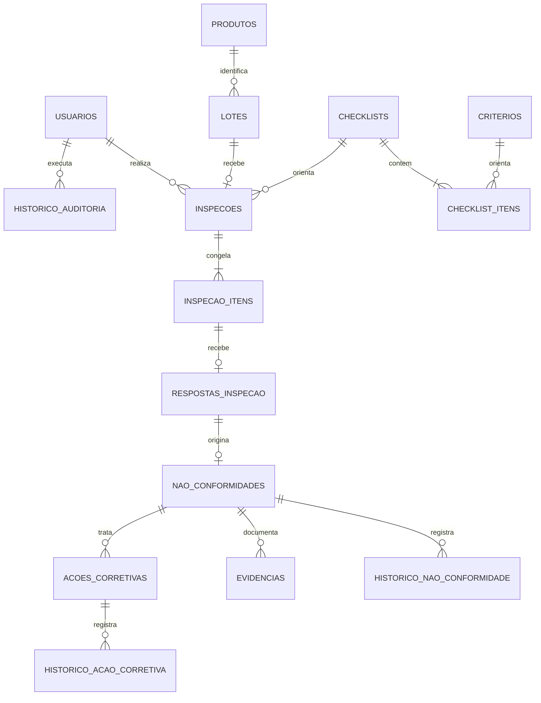

# PostgreSQL do GP4

Este diretório contém o esquema relacional inicial pedido no plano individual de Luiz. As migrations modelam os cadastros, snapshots de inspeção, respostas, desvios, evidências, ações corretivas, sessões, tentativas de login e auditoria.

## Subir uma instância local

Na raiz do repositório, copie `.env.example` para `.env` e troque `GP4_DB_PASSWORD` por uma senha forte. O Compose publica a porta somente em `127.0.0.1` e guarda os dados no volume `gp4-postgres`:

```sh
docker compose -f compose.database.yaml up -d
```

O serviço de migration recebe os dados de conexão do `.env` raiz. Se preferir rodar o script PHP diretamente no host, configure `backend/.env`:

```dotenv
DATABASE_DSN=pgsql:host=127.0.0.1;port=5432;dbname=gp4
DATABASE_USER=gp4
DATABASE_PASSWORD=sua-senha-local
```

O container de ferramenta inclui PHP CLI e `pdo_pgsql`. Aplique as migrations versionadas:

```sh
docker compose -f compose.database.yaml --profile tools run --rm migrate
```

O comando registra as versões em `schema_migrations`, usa transação e bloqueio consultivo para impedir aplicação simultânea da mesma migration. Migrations já aplicadas não são repetidas.

## Dados fictícios

Em uma instância local vazia, carregue cenários de aprovação, reprovação, desvio, evidência e ação corretiva:

```sh
docker compose -f compose.database.yaml --profile tools run --rm migrate php bin/seed-demo.php
```

O seed é recusado em `APP_ENV=production` e se já houver usuários. Ele cria três contas fictícias (`admin@gp4.invalid`, `supervisor@gp4.invalid`, `inspetor@gp4.invalid`), todas com senha `password`. Essas credenciais são apenas para demonstração local; não as use em uma instalação compartilhada.

## Backup e restauração

Execute a partir da raiz do repositório. O arquivo contém dados pessoais e evidências; guarde-o em local privado:

```sh
pg_dump --format=custom --no-owner --host=127.0.0.1 --port=5432 --username=gp4 --dbname=gp4 --file=gp4.backup
```

Restaure em um banco vazio (o `pg_restore --clean` remove objetos existentes e deve ser usado somente depois de confirmar o destino):

```sh
createdb --host=127.0.0.1 --port=5432 --username=gp4 gp4_restore
pg_restore --no-owner --host=127.0.0.1 --port=5432 --username=gp4 --dbname=gp4_restore gp4.backup
```

Verifique o resultado com consultas de contagem e confira relações usando `backend/database/queries/relatorios.sql`.

## Modelo e decisões



- `usuarios`: identidade, email único sem distinção entre maiúsculas/minúsculas, hash da senha, perfil e ativação.
- `produtos`, `lotes`, `criterios`, `checklists`: cadastros versionados por código/nome, com exclusão lógica via `ativo`.
- `checklist_itens`: critérios ordenados por checklist, com obrigatoriedade e no máximo uma ocorrência do mesmo critério.
- `inspecoes`, `inspecao_itens`: lote único por inspeção e cópias dos nomes/itens usados no momento da abertura.
- `respostas_inspecao`: uma resposta por item da inspeção; justificativa obrigatória para `nao_aplicavel`.
- `nao_conformidades`, `historico_nao_conformidade`: no máximo um desvio por resposta e trilha de transições com autor/data.
- `evidencias`: MIME permitido, tamanho limitado, hash SHA-256 e bytes originais em `bytea`.
- `acoes_corretivas`, `historico_acao_corretiva`: ação, responsável/prazo e trilha de estado prevista no plano.
- `historico_auditoria`: autor, ação, recurso e detalhes JSONB sem armazenar credenciais ou tokens.
- `sessoes`, `tentativas_login`: somente hash SHA-256 do token/IP, expiração e contagem de falhas.

- Um lote tem um produto; uma inspeção por lote, enforced por `UNIQUE(lote_id)`.
- A inspeção guarda nomes e itens em snapshot para que alterações futuras nos cadastros não mudem o histórico.
- Respostas apontam para itens do snapshot; cada item recebe no máximo uma resposta e cada resposta pode gerar no máximo um desvio.
- Exclusão de cadastros referenciados é bloqueada por `ON DELETE RESTRICT`; o fluxo funcional deve desativá-los.
- Fotos ficam em `bytea` nesta primeira versão para preservar a consistência transacional. Se o volume crescer, mover bytes para storage privado exigirá chaves de objeto e compensação/outbox.
- Ações corretivas estão modeladas como tabela independente conforme o plano, embora ainda não existam rotas de API para criá-las ou atualizá-las.

## Estado da integração

O esquema e os comandos de provisionamento estão versionados, mas a API PHP ainda instancia `JsonStore` em `backend/bootstrap.php`. A troca da persistência usada em produção exige o adaptador de repositórios PostgreSQL e a migração controlada dos arquivos JSON. Até essa etapa, executar as migrations cria um banco separado e não muda a origem dos dados do site.
