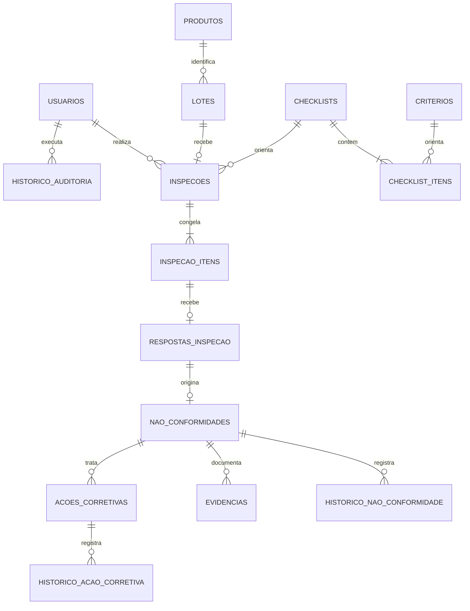

# MySQL do GP4

Este diretório contém o esquema relacional do projeto convertido para **MySQL 8.4 LTS**, que pode ser administrado pelo phpMyAdmin. O phpMyAdmin oferece suporte a bancos compatíveis com MySQL, incluindo MySQL e MariaDB; este Compose fixa MySQL 8.4. [Documentação do phpMyAdmin](https://docs.phpmyadmin.net/en/latest/require.html) [Política de versões MySQL](https://dev.mysql.com/doc/refman/8.4/en/mysql-releases.html)

## Subir MySQL e phpMyAdmin localmente

Na raiz do repositório, copie `.env.example` para `.env` e configure senhas fortes para `GP4_DB_PASSWORD` e `GP4_DB_ROOT_PASSWORD`. O banco e o phpMyAdmin ficam disponíveis apenas no computador local; os dados persistem no volume Docker `gp4-mysql`.

```sh
docker compose -f compose.database.yaml up -d
```

Abra `http://127.0.0.1:8081/` no navegador e entre com o usuário e senha configurados em `GP4_DB_USER` e `GP4_DB_PASSWORD`. O schema é criado no banco `GP4_DB_NAME` pelo comando abaixo; o usuário da aplicação tem privilégios apenas nesse banco.

## Aplicar migration e dados de demonstração

O container auxiliar compila `pdo_mysql` e aplica as migrations versionadas:

```sh
docker compose -f compose.database.yaml --profile tools run --rm migrate
```

Em um banco local vazio, o seed cria três perfis e cenários fictícios de inspeção aprovada/reprovada, desvio, evidência e ação corretiva:

```sh
docker compose -f compose.database.yaml --profile tools run --rm migrate php bin/seed-demo.php
```

Contas do seed: `admin@gp4.invalid`, `supervisor@gp4.invalid` e `inspetor@gp4.invalid`; senha `password`. Use essas credenciais somente na demonstração local. O seed recusa `APP_ENV=production` e banco que já tenha usuários.

MySQL faz commit implícito em operações DDL, então uma migration parcialmente aplicada não pode ser revertida pela transação do PHP. Se a primeira migration falhar num banco demonstrativo recém-criado, remova e recrie **somente esse banco vazio** antes de reaplicar; não apague volume que contenha dados que queira preservar.

## Estrutura e regras



- Cadastros guardam estado ativo/inativo; FKs usam `RESTRICT` para preservar histórico.
- Um lote tem um produto e só pode ter uma inspeção. A inspeção guarda snapshots dos nomes e dos critérios usados.
- Respostas são únicas por item da inspeção; cada resposta pode originar no máximo uma não conformidade.
- `acoes_corretivas` e seu histórico estão previstos no plano, mas ainda não têm endpoints na API.
- Datas usam `DATETIME(6)` e são gravadas em UTC; evidências de até 5 MiB ficam em `MEDIUMBLOB` com MIME, tamanho e SHA-256.
- Email, códigos e nomes únicos usam collation case-insensitive accent-sensitive. O banco usa `utf8mb4`.
- `historico_auditoria.detalhes` usa JSON nativo do MySQL.

Consultas de indicadores e histórico prontas para a aba SQL do phpMyAdmin ficam em `queries/relatorios.sql`; ajuste as variáveis `@data_inicio`, `@data_fim`, `@produto_id`, `@lote_id`, `@inspetor_id` e `@status` antes de executá-las.

## Backup e restauração

Use `mysqldump` e `mysql` instalados no host, se disponíveis. Mantenha o backup em local privado:

```sh
mysqldump --single-transaction --host=127.0.0.1 --port=3306 --user=gp4 --password gp4 > gp4.sql
mysql --host=127.0.0.1 --port=3306 --user=gp4 --password gp4 < gp4.sql
```

O segundo comando importa no banco `gp4`; para evitar sobrescrever dados, restaure primeiro em um banco vazio de nome diferente. No phpMyAdmin, também é possível exportar/importar o banco pela tela, mas confira os limites de upload se o arquivo contiver evidências.

## Limite da integração atual

O schema e a administração pelo phpMyAdmin estão preparados, mas a API segue usando `JsonStore` em `backend/bootstrap.php`, conforme solicitado. Aplicar a migration cria um banco separado: não altera a API e não copia os arquivos JSON existentes.
