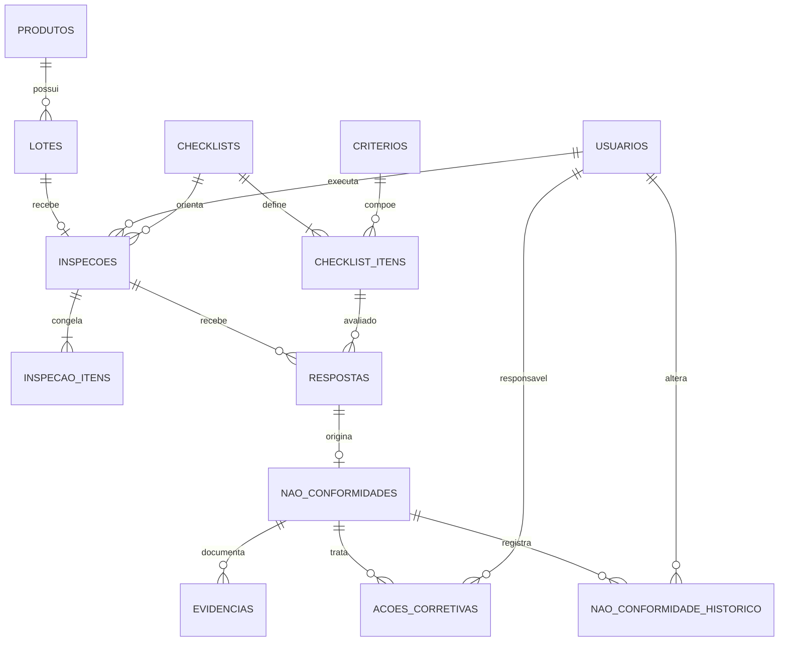

# Modelagem relacional e entrega de Luiz

## Leitura dos requisitos

O enunciado exige persistência relacional, cadastro de produtos/lotes/inspetores/critério, inspeções, não conformidades, histórico, evidências, pesquisa, indicadores e relatórios. Perfis exatos, aprovação automática, inspeção única por lote, classificações e transições de estado são decisões de implementação propostas nos PDFs. Esta versão mantém as decisões já adotadas pelo contrato da API: uma inspeção por lote, lote aprovado se todas as respostas forem conformes/aplicáveis, e reprovado se houver resposta não conforme.

## DER lógico



`inspecao_itens` congela nome, descrição e obrigatoriedade dos critérios na abertura. A FK composta em `respostas` faz o banco rejeitar resposta cujo item não pertence ao checklist daquela inspeção. A unicidade em `inspecoes.lote_id` implementa a regra proposta de inspeção única por lote. Exclusões históricas usam RESTRICT por padrão; registros operacionais são desativados em vez de apagados. A migration 003 adiciona auditoria de alterações e ações corretivas planejadas, ainda sem endpoints HTTP para gerenciá-las.

## Dicionário resumido

| Tabela | Chaves e campos principais | Regras / finalidade |
| --- | --- | --- |
| usuarios | `id`, `email`, `senha_hash`, `perfil`, `ativo`, `token_version` | Email único normalizado; hash somente; perfis admin/supervisor/inspetor. |
| produtos | `id`, `codigo`, `nome`, `ativo` | Código único; cadastro desativável. |
| lotes | `id`, `codigo`, `produto_id`, `quantidade`, `status`, `ativo` | Produto obrigatório; quantidade positiva; código único. |
| criterios | `id`, `nome`, `descricao`, `ativo` | Critério reutilizável; imutável após uso em inspeção. |
| checklists | `id`, `nome`, `descricao`, `ativo` | Modelo; seus itens ficam protegidos durante inspeção. |
| checklist_itens | `id`, `checklist_id`, `criterio_id`, `obrigatorio` | Um critério aparece uma vez em cada checklist. |
| inspecoes | `id`, `lote_id`, `checklist_id`, `inspetor_id`, `status`, `iniciada_em`, `finalizada_em` | Responsável e checklist obrigatórios; estado final coerente com data. |
| inspecao_itens | `(inspecao_id,item_id)`, `criterio_nome`, `criterio_descricao`, `obrigatorio` | Snapshot do critério em uso. |
| respostas | `id`, `inspecao_id`, `item_id`, `checklist_id`, `resultado`, `observacao` | Resultado limitado; item e checklist precisam corresponder; par único. |
| nao_conformidades | `id`, `resposta_id`, `descricao`, `classificacao`, `status`, `criado_em` | No máximo um desvio por resposta; menor/maior/crítica. |
| evidencias | `id`, `nao_conformidade_id`, `nome_original`, `nome_arquivo`, `tipo`, `tamanho` | Metadados do arquivo privado, não o binário. |
| nao_conformidade_historico | `id`, `nao_conformidade_id`, `usuario_id`, `status`, `criado_em` | Cada transição mantém ator e instante. |
| acoes_corretivas | `id`, `nao_conformidade_id`, `descricao`, `responsavel_id`, `prazo`, `status` | Plano associado ao desvio; estados validados por CHECK. |
| historico_auditoria | `id`, `tabela`, `registro_id`, `operacao`, `usuario_id`, `ocorrido_em`, `antes`, `depois` | Trigger registra alterações. Hashes de usuários não entram na trilha. |
| gp4_migrations | `nome`, `aplicada_em` | Controle das migrations aplicadas. |

Identificadores são `BIGSERIAL`; datas usam `TIMESTAMPTZ`; cadastros mantêm criação/atualização e respostas registram criação; quantidades/tamanhos são inteiros; estados são `VARCHAR` com CHECK para compatibilidade com a API. Índices cobrem lote/produto, inspetor, checklist, data, resposta e histórico de desvio. O contrato executável completo está em `sql/001_inicial.sql` a `sql/003_auditoria_acoes.sql`.

## Auditoria com autoria

O trigger preserva antes/depois como JSONB em `historico_auditoria`. A aplicação define `gp4.usuario_id` com `set_config(..., true)` dentro da transação autenticada, logo o contexto não vaza para a próxima conexão do pool. Alterações diretas via ferramenta SQL sem esse contexto ficam com autor nulo; em produção, restrinja acesso direto e use conta de migração separada. A tabela `usuarios` foi excluída do trigger para não gravar hash de senha.

## Carga fictícia

Em banco de desenvolvimento já migrado, configure uma senha descartável e execute:

```powershell
$env:GP4_LOAD_DEMO_DATA = 'true'
$env:GP4_DEMO_PASSWORD = Read-Host 'Senha fictícia de demonstração (mínimo 12 bytes)'
npm.cmd run db:seed:demo
Remove-Item Env:GP4_LOAD_DEMO_DATA, Env:GP4_DEMO_PASSWORD
```

A carga cria três perfis, um produto, três critérios, checklist e três lotes: aprovado, reprovado com desvio e em andamento. Pode ser repetida: atualiza contas/cadastros fictícios e cria os cenários somente se ainda não existirem; interrompe se encontrar carga parcial para evitar apagar histórico ou arquivos. Não use em produção nem reutilize senha real. Não cria evidência binária; anexos devem ser enviados pela API para respeitar validação e armazenamento privado.

## Consultas de referência

```sql
-- Inspeções por período, lote, produto e responsável.
SELECT i.id, i.status, i.iniciada_em, p.codigo AS produto_codigo,
       l.codigo AS lote_codigo, u.nome AS inspetor
FROM inspecoes i
JOIN lotes l ON l.id=i.lote_id
JOIN produtos p ON p.id=l.produto_id
JOIN usuarios u ON u.id=i.inspetor_id
WHERE i.iniciada_em >= $1 AND i.iniciada_em < $2
  AND ($3::bigint IS NULL OR l.id=$3)
  AND ($4::bigint IS NULL OR p.id=$4)
  AND ($5::bigint IS NULL OR u.id=$5)
ORDER BY i.iniciada_em DESC;

-- Desvios por classificação, produto e período.
SELECT p.nome AS produto, n.classificacao, count(*) AS desvios
FROM nao_conformidades n
JOIN respostas r ON r.id=n.resposta_id
JOIN inspecoes i ON i.id=r.inspecao_id
JOIN lotes l ON l.id=i.lote_id
JOIN produtos p ON p.id=l.produto_id
WHERE i.iniciada_em >= $1 AND i.iniciada_em < $2
GROUP BY p.nome,n.classificacao ORDER BY p.nome,n.classificacao;

-- Indicador: aprovação usa somente inspeções finalizadas.
SELECT count(*) FILTER (WHERE status='aprovada') AS aprovadas,
       count(*) FILTER (WHERE status='reprovada') AS reprovadas,
       round(100.0 * count(*) FILTER (WHERE status='aprovada') /
         NULLIF(count(*) FILTER (WHERE status IN ('aprovada','reprovada')),0),2) AS taxa_aprovacao
FROM inspecoes WHERE iniciada_em >= $1 AND iniciada_em < $2;
```

A taxa fica zero na aplicação quando não há inspeção finalizada. Para SQL direto, envie limites `timestamptz` explícitos. As consultas da API usam parâmetros e listas permitidas de ordenação.

## Backup e restauração

Use `scripts/backup.ps1` e `scripts/restore.ps1` com PostgreSQL 16/17 instalado. O backup custom-format inclui esquema e dados do banco. Restaure apenas em banco vazio de homologação: o script interrompe se encontrar objetos. Em operação real, agende backups, mantenha cópias criptografadas fora do host e inclua o diretório privado de fotos, porque o PostgreSQL guarda somente metadados. Valide periodicamente restauração e reconciliação de contagens/arquivos.
